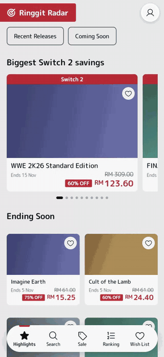
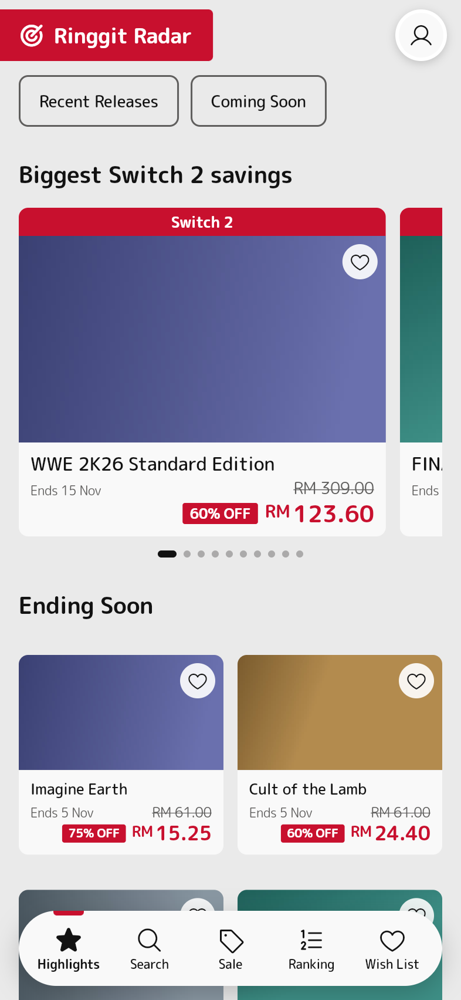
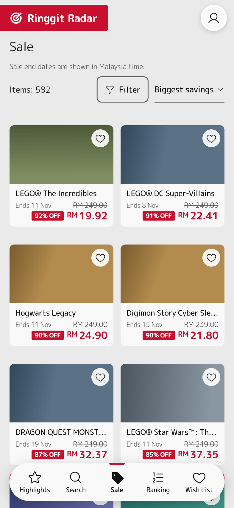
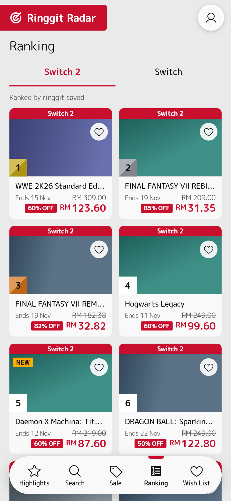
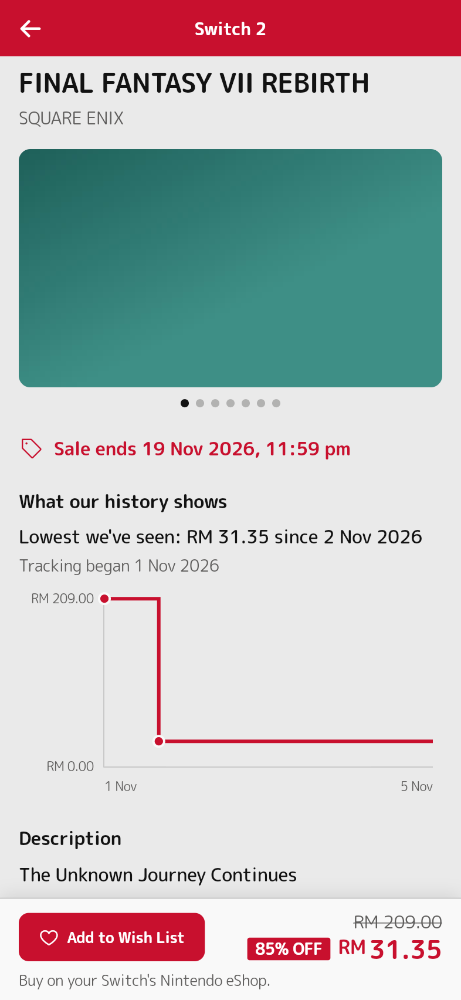
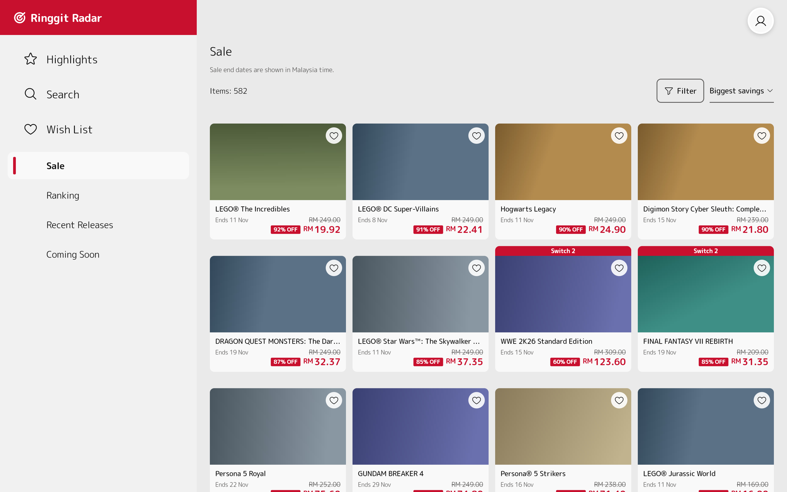

# Ringgit Radar

Unofficial price tracker for Malaysian Nintendo eShop prices, in MYR. A Go collector records prices into local Postgres, a read API serves them, and a Flutter app (web, Android, iOS) shows them. Not affiliated with or endorsed by Nintendo.

**Try it:** [ringgit-radar-nine.vercel.app](https://ringgit-radar-nine.vercel.app) · Android: [download the APK](https://ringgit-radar-nine.vercel.app/android.html)

<p align="center">
  
</p>

| Highlights | Sale | Ranking | Game page |
| --- | --- | --- | --- |
|  |  |  |  |



Cover art in these screenshots is replaced with plain tiles. The prices, dates and charts are real, from the live site on 5 Nov 2026.

Setup: `createdb eshop_radar && for f in backend/db/migrations/*.sql; do psql -d eshop_radar -f $f; done`
Collect one sweep (from `backend/`): `go run ./cmd/collector` (optional `USER_AGENT`)
Daily sweep at 01:17 on macOS (from `backend/`, rebuild after collector changes): `go build -o collector ./cmd/collector && cp launchd/com.eshopradar.collector.plist ~/Library/LaunchAgents/ && launchctl bootstrap gui/$(id -u) ~/Library/LaunchAgents/com.eshopradar.collector.plist`. It writes to Supabase, reading `SUPABASE_SESSION_URL` from the root `.env`. Log: `~/Library/Logs/eshop-radar-collector.log`; failures are also recorded in `collection_runs`.
Age ratings (one shot, GitHub only; `TITLEDB_PATH` reads a local copy): `go run ./cmd/importratings`
API on 127.0.0.1:8088 (`PORT`, `DATABASE_URL`, `IMG_CACHE`): `go run ./cmd/api`
App (from `apps/flutter_app/`): `flutter run -d chrome --dart-define=API_BASE=http://127.0.0.1:8088`
Web build (from `apps/flutter_app/`): `flutter build web --wasm --no-web-resources-cdn --dart-define=API_BASE= --output <dir>`. An empty `API_BASE` makes the app call the address it was loaded from; `--no-web-resources-cdn` keeps the engine on our own server, and the one fallback font the engine asks for at start-up is bundled (`assets/gfonts`), so the browser contacts no third party. Build to a separate `--output` while something is serving from `build/web`.
One process, app and API together (from `backend/`): `HOST=127.0.0.1 PORT=8088 PUBLIC=true WEB_DIR=<dir> go run ./cmd/api`. A non-loopback `HOST` needs `SITE_PASSWORD=<choose one>` (everything except `/healthz` asks for it, any username) or `PUBLIC=true` (no password); with neither, or both, it refuses to start. `TRUST_PROXY=true` believes `X-Forwarded-For` (right behind Vercel; `cloudflare` also believes `Cf-Connecting-Ip`), so the rate limit counts the visitor. `RATE_LIMIT_PER_MIN` (600 per address on `/v1`), `IMG_UPSTREAM_PER_HOUR` (600 fetches from the image source; cached images never count) and `IMG_CACHE` (`none` for no disk) tune it; `0` turns a limit off.

## Public release: Vercel, Supabase, a Raspberry Pi

The static web app and the API run on Vercel (a free Hobby account, region `sin1`); Postgres is Supabase Free (Singapore); the nightly sweep and a backup run on a Pi at home, because a sweep takes about 4 to 5 minutes and a Vercel function stops at 300 s. Nothing here costs money.

1. **Supabase.** Create a project in Singapore. Copy the existing database, so run 1's history is kept and never recreated: `pg_dump -Fc --no-owner --no-privileges -d eshop_radar -f ringgit.dump`, then `pg_restore --no-owner --no-privileges -d '<session pooler URL>' ringgit.dump` (the session pooler, port 5432: the direct connection is IPv6 only on the free plan). Check `select count(*) from price_history` on both sides. `pg_dump` must be at least the server's major version. Then close Supabase's automatic API, which would otherwise expose these tables to anyone holding the public key: in the dashboard turn **Enable Data API** off, and in the SQL editor run `do $$ declare t text; begin for t in select tablename from pg_tables where schemaname = 'public' loop execute format('alter table public.%I enable row level security', t); end loop; end $$; revoke all on all tables in schema public from anon, authenticated; revoke all on all sequences in schema public from anon, authenticated; alter default privileges for role postgres in schema public revoke all on tables from anon, authenticated; alter default privileges for role postgres in schema public revoke all on sequences from anon, authenticated;`. The site and the Pi connect as `postgres`, which owns the tables, so row level security does not get in their way.
2. **Vercel.** The Vercel project root is `backend/` (that is where `go.mod` is). From the repo root:
   ```
   (cd apps/flutter_app && flutter build web --wasm --no-web-resources-cdn --dart-define=API_BASE= --output ../../backend/public)
   cd backend
   npx vercel link                                  # once; creates .vercel/, gitignored
   npx vercel env add DATABASE_URL production       # the transaction pooler URL (port 6543), see below
   npx vercel deploy --prod
   ```
   `public/` is the static site, `api/index.go` is the one Go function behind `/v1/*` and `/healthz`, `serverless/` holds its code (it reuses the router `cmd/api` uses, and sits outside `api/` because Vercel's Go builder cannot import `internal/` from there), and `vercel.json` has the region, rewrites and headers. `npx vercel build` needs no deploy and shows a build failure locally. `DATABASE_URL` for the function: `postgres://postgres.<ref>:<password>@aws-0-<region>.pooler.supabase.com:6543/postgres?default_query_exec_mode=simple_protocol&pool_max_conns=2` (a transaction pooler has no prepared statements). Optional env: `RATE_LIMIT_PER_MIN`, `IMG_UPSTREAM_PER_HOUR` (both counted per running function instance), `TRUST_PROXY` (default `true`).
3. **The Pi** (`backend/deploy/pi/`): from `backend/`, `CGO_ENABLED=0 GOOS=linux GOARCH=arm64 go build -trimpath -ldflags="-s -w" -o deploy/pi/collector-linux-arm64 ./cmd/collector` (a 32-bit OS needs `GOARCH=arm GOARM=7`), `scp -r deploy/pi pi@<pi>:ringgit-pi`, then over SSH `sudo sh ringgit-pi/install.sh` and put the session pooler `DATABASE_URL` in `/etc/ringgit-radar/env` (root-owned, mode 600, never in the repo). It installs a timer for the sweep at 01:17 Malaysia time (`Persistent=true`) and one for a `pg_dump -Fc` backup at 03:17 that keeps 14 days and fails loudly. Test with `sudo systemctl start ringgit-collector` and `journalctl -u ringgit-collector`. `pg_dump` on the Pi must be at least the server's major version.
4. **Android.** `(cd apps/flutter_app && flutter build apk --release --dart-define=API_BASE=https://<project>.vercel.app)`, copy `build/app/outputs/flutter-apk/app-release.apk` to `backend/public/ringgit-radar.apk` and deploy again; the site then serves the download, and `/android.html` (from `apps/flutter_app/web/`) is the page to share. Each new web build empties `backend/public`, so copy the APK in again afterwards. The APK is signed with the upload key through `android/key.properties` (see below).
5. **Until the Pi takes over** the Mac's launchd sweep (above) is the interim. It must never run at the same time as the Pi's timer: `launchctl bootout gui/$(id -u)/com.eshopradar.collector` before the Pi's first night.

Android release (from `apps/flutter_app/`): create `android/key.properties` (gitignored) with `storeFile`, `storePassword`, `keyAlias`, `keyPassword` for your upload key, then `flutter build apk --release --dart-define=API_BASE=https://<your site>`. Without that file a release build is signed with the debug key and must not be shared. The app id is `my.ringgitradar.app`; the icons come from `python3 tool/make_icons.py`.

Tests: `TEST_DATABASE_URL=postgres:///eshop_radar_test go test ./...` in `backend/` (needs a migrated `eshop_radar_test`), `flutter analyze && flutter test` in the app.
